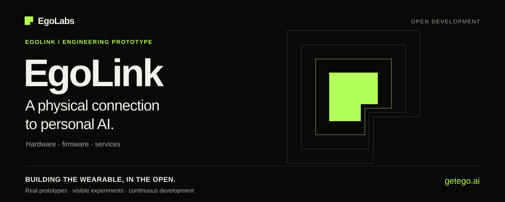
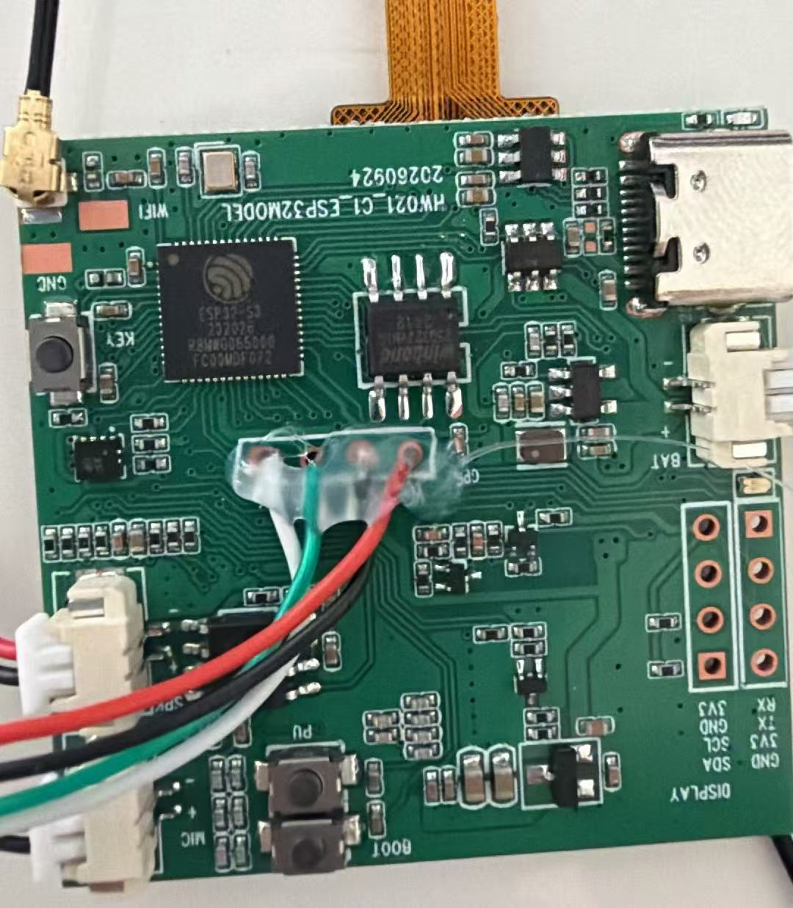

# EgoLink



**A wearable connection between personal AI and the physical world.**

[中文](README.zh-CN.md) · [EgoLabs](https://github.com/getegoai) · [Project Ego](https://github.com/getegoai/ego) · [getego.ai](https://getego.ai) · [Roadmap](docs/ROADMAP.md)

EgoLink combines location, motion sensing, cellular communication, and physical user controls. We are developing its hardware, firmware, backend, and tools together, starting with location, two-way cellular calling, and a physical SOS workflow.

It is the wearable part of [Ego](https://github.com/getegoai/ego), our longer-term project for personal AI under the user's control. EgoBase is the user-controlled endpoint being developed for history, context, and further processing. Basic device interaction and help requests are intended to keep working when Base or AI is unavailable.

## Current status

**The actual firmware, backend, hardware materials, tools, and development history are now included.** This is an engineering prototype with known defects and incomplete features. Development continues here through commits, issues, and pull requests.

<p align="center"><a href="docs/VISUAL_TOUR.md"></a></p>

*The actual PCB1 engineering prototype. Explore the [visual tour](docs/VISUAL_TOUR.md)
for the opposite side, assembly context and downloadable project artwork.*

The source baseline extends through October 23, 2026. Project records from October 21–22 report cellular registration, telemetry upload, local logging, queued upload recovery, a connected VoLTE call, and an SOS backend alert on the custom ESP32-S3 / ML307A `PCB1`.

These are bounded bench results. Representative location, full-duplex calling, and end-to-end SOS product acceptance remain open. PCB1 has documented camera, charging, audio, and pin-allocation issues. Battery life, model accuracy, and a fully local data path are not established; current development includes a server-side collection path.

The PCB1 firmware builds with ESP-IDF 5.4.2 during public-import preparation; no new hardware test was performed. See [import validation](docs/PUBLIC_IMPORT_VALIDATION.md) for the exact build/test environment, results, and remaining failures, and [history](docs/HISTORY.md) for the original development sequence and privacy edits.

## Repository map

| Path | Work |
|---|---|
| [firmware/hw021_pcb1_bringup/](firmware/hw021_pcb1_bringup/) | Current custom PCB1 bring-up and integrated runtime |
| [firmware/mqtt_heartbeat/](firmware/mqtt_heartbeat/) | Retained ESP-IDF device runtime and shared components for sensing, communication, storage, and state |
| [hardware/](hardware/) | Prototype PCB and mechanical materials, with revision-specific limitations |
| [server/](server/) | Python telemetry/message hub, history, alerts, and web surfaces; a separate Java service under `ego-cloud-backend/` |
| [shared/contracts/](shared/contracts/) | Versioned observation, state, event, command, and receipt schemas |
| [pc_simulator/](pc_simulator/), [scripts/](scripts/), [quality_tests/](quality_tests/) | Host tools, replay, calibration, and verification |
| [model_lab/](model_lab/), [model_artifacts/](model_artifacts/) | Model development and retained rule/synthetic integration artifacts; see their model cards for scope |

Current engineering context starts at [CONTEXT_INDEX](docs/CONTEXT_INDEX.md). Dated status and bench records describe their own board and revision; they are not interchangeable with a new build.

## Run and build

Start the Python message hub from the repository root:

```sh
python scripts/run_message_hub.py --host 127.0.0.1 --port 8790
```

Open `http://127.0.0.1:8790`. The local hub can start without a device; live telemetry requires your configured device. The separate Java backend has its dependencies in [pom.xml](server/ego-cloud-backend/pom.xml) and requires its own service configuration.

For the Java service, copy [`.env.example`](server/ego-cloud-backend/.env.example) to `.env` in that service directory and set `MYSQL_ROOT_PASSWORD`, `DB_PASSWORD`, and `DEVICE_AUTH_TOKEN` before using Compose. Both the database and backend use the same `DB_PASSWORD`. For direct Java startup, export the corresponding environment variables. Private deployment addresses, Wi-Fi credentials, device identifiers, and phone numbers in the imported history have been replaced; configure your own values locally.

For PCB1, activate an **ESP-IDF 5.4.2** environment. From the repository root in PowerShell, build using a new generated configuration and build directory:

```powershell
$repo = (Get-Location).Path
python "$env:IDF_PATH/tools/idf.py" -C firmware/hw021_pcb1_bringup -B "$repo/build/pcb1" -D "SDKCONFIG=$repo/build/pcb1/sdkconfig" -D "SDKCONFIG_DEFAULTS=$repo/firmware/hw021_pcb1_bringup/sdkconfig.defaults" build
```

The component manifest pins `esp32-camera` 2.1.7 and `esp_jpeg` 1.3.1. Consult the [PCB1 notes](firmware/hw021_pcb1_bringup/README.md), [board matrix](docs/hardware/BOARD_MATRIX.md), and [import validation](docs/PUBLIC_IMPORT_VALIDATION.md) before using hardware. Compiling does not verify board operation.

Existing host checks:

```sh
python -m pip install jsonschema cryptography numpy pandas
python scripts/context_lint.py
python -m unittest discover -s quality_tests -v
```

Python 3.12 was used for the import checks. Set `CC` to a native GCC executable and put its directory on `PATH` for the host C tests. Some checks need ESP-IDF or explicitly configured integrations. The validation record distinguishes executed checks, environment errors, failures, and untested paths.

## Next development

- Resolve custom-board issues and improve independent battery-powered operation.
- Verify complete audio/call and SOS workflows, location quality, and outage/restart recovery.
- Connect a minimum user-controlled EgoBase storage and replay endpoint.
- Continue through real commits, issues, and pull requests; see the [roadmap](docs/ROADMAP.md).

## Participate and license

Contribute to the actual device and software: report a problem, review a protocol, test a supported board, improve documentation, or propose code. Start with [issues](https://github.com/getegoai/egolink/issues) or [CONTRIBUTING.md](CONTRIBUTING.md).

Original software, contracts, tests, and the identified project-generated synthetic model assets use **Apache-2.0**. Original prose documentation and the project's own hardware designs use **CC BY 4.0**. Third-party materials retain their licenses. See [LICENSING.md](LICENSING.md), the [Apache license](LICENSE), and [third-party notices](THIRD_PARTY_NOTICES.md) for scope.
