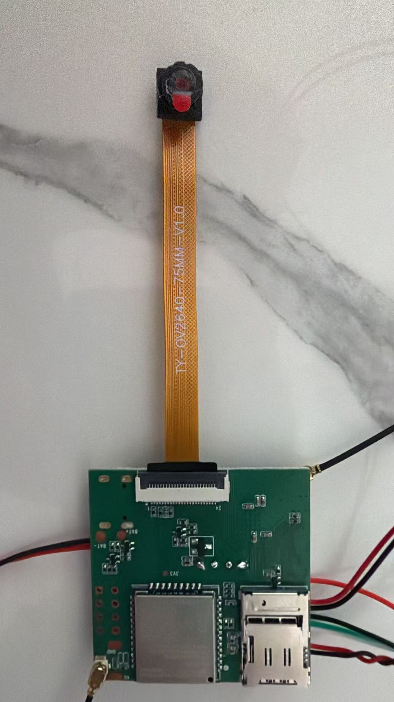

# EgoLink in pictures / EgoLink 图片导览

EgoLink is an engineering prototype developed in public. This page brings together
the actual board photographs and reusable project artwork. / EgoLink 正在公开研发，
这里展示现有原型实拍，并提供可以直接用于项目介绍的图片。

## The current prototype / 当前原型

**PCB1 · component side / 元件面。** An existing project photograph of the custom
board, including the ESP32-S3, USB-C connector, physical buttons and development
wiring. The original image is retained. / 自制板实拍，展示处理器、接口、实体按键和
研发接线；保留原图。这是当前研发载体，外壳和整机形态仍在演进。

**PCB1 · opposite side and camera flex / 背面与相机排线。** This photograph records
the assembly, not a camera validation result. The [board review](hardware/HW021_PCB1_BRINGUP_AND_REVIEW_20261020.md)
records camera wiring and other rework items. / 图片记录实际装配形态；相机接线及其他
返修项见板卡审查，不能仅凭镜头已接上就认定相机链路可用。

Current engineering results and open work are recorded in
[STATUS](current/STATUS.md), [ACTIVE_BUILD](current/ACTIVE_BUILD.md) and the
[import validation](PUBLIC_IMPORT_VALIDATION.md). / 当前工程结果与待完成工作见上述记录。

## The larger project / 在 Ego 中的位置

EgoLink provides physical observations and interaction. EgoBase is being developed
as a user-controlled destination for evidence, context and authorized action.
See the [Ego visual tour](https://github.com/getegoai/ego/blob/main/docs/VISUAL_TOUR.md)
for the conceptual relationship and real Data Core software screenshots.
The complete Link-to-Base integration remains in development.

EgoLink 是物理观察与交互入口；EgoBase 承接个人掌控的证据、上下文与授权行动。
总项目图片导览包含关系示意图和 Data Core 真实软件截图，完整跨设备闭环仍在实现中。

## Ready to share / 可直接取用

| Asset / 图片 | Use / 用途 |
|---|---|
| [README cover · SVG](media/egolink-cover.svg) · [PNG](media/egolink-cover.png) | 1600 × 640，仓库封面、演示文稿章节页 |
| [Social card · PNG](media/egolink-social.png) · [SVG source](media/egolink-social.svg) | 1200 × 630 PNG，X 等平台的项目介绍配图 |
| [PCB1 component side](../hardware/PCB1/2.jpg) | 现有真实研发细节图；不是成品宣传照 |
| [PCB1 opposite side](../hardware/PCB1/5.jpg) | 说明装配结构与相机连接 |

Suggested caption / 可用配文：

> We're building EgoLink in the open: hardware, firmware, services, experiments
> and the decisions behind them. This is our current engineering prototype.
>
> 我们正在公开研发 EgoLink：硬件、固件、服务、实验，以及每一步的取舍。
> 图中是当前工程原型，代码与研发历史都在 GitHub。

See [asset sources and regeneration](media/README.md). The next three useful
photographs are described in the [short photo brief](media/PHOTO_BRIEF.zh-CN.md).
